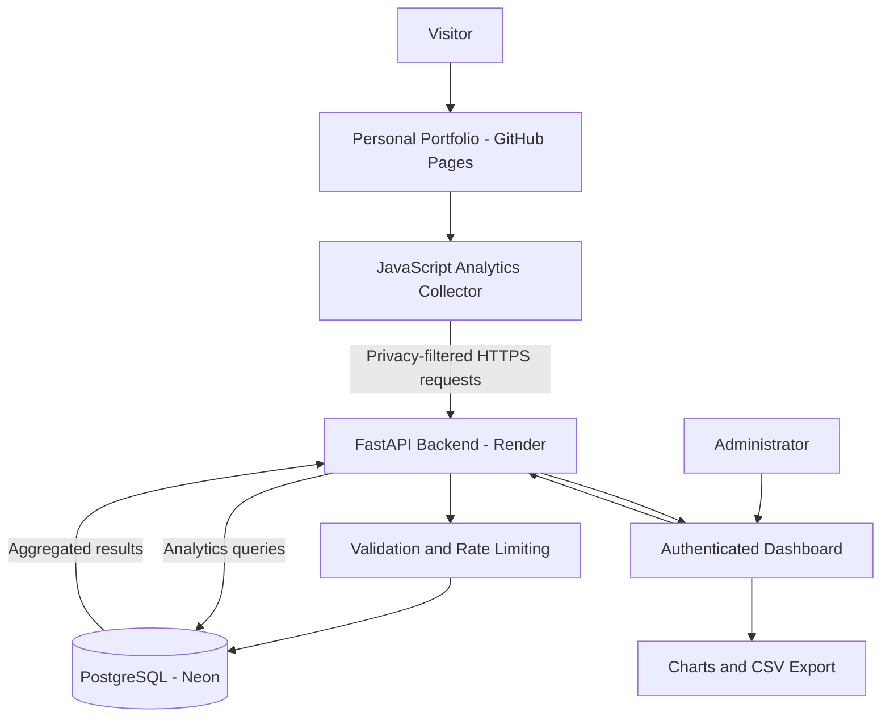

# PortfolioPulse

### A privacy-conscious analytics platform for my personal portfolio

## How it started

I originally built my personal portfolio during my senior year of undergraduate studies using HTML, CSS and JavaScript. It was a fairly simple frontend, and admittedly, not everything worked the way it was supposed to.

Over time, as I worked on more projects and completed my Master's in Data Science, my portfolio evolved along with me. However, there was one thing I was always curious about: how were people actually interacting with it?

Were visitors exploring my projects? Were they downloading my resume? Which projects attracted the most attention? Were people finding my portfolio through LinkedIn, GitHub or other sources?

Instead of integrating an existing analytics service, I decided to build one myself.

What started with fixing a dark mode toggle eventually turned into PortfolioPulse, a full-stack analytics application with a cloud-hosted backend, a PostgreSQL database and a private analytics dashboard.

This project gave me an opportunity to explore backend engineering, database management, application security, automated testing and cloud deployment beyond my usual work in AI and machine learning.

---

## What is PortfolioPulse?

PortfolioPulse is a custom analytics platform that helps me understand how visitors engage with my professional portfolio while collecting only limited information about their browsing activity.

The portfolio remains a lightweight, static website. Analytics are handled independently by a backend service, and the collected data can be viewed through a password-protected dashboard.

**Live portfolio:**
[saeedesai.github.io/personal-portfolio-saee](https://saeedesai.github.io/personal-portfolio-saee/)

The analytics dashboard is restricted to authenticated administrator access.

---

## Features

### Traffic and visitor analytics

- Total page views and approximate browsing sessions
- Daily traffic trends
- Referral source attribution
- UTM campaign tracking
- Estimated device categories
- Date-based filtering for the last 24 hours, 7 days, 30 days and 90 days

### Portfolio engagement

- Resume link clicks
- Individual project interactions
- GitHub profile clicks
- Research publication interactions
- LinkedIn and email link clicks
- Scroll depth milestones
- Estimated active viewing duration
- Session-based engagement rate

### Private analytics dashboard

- Interactive charts and summary metrics
- Project performance rankings
- Publication engagement statistics
- Campaign performance breakdown
- Manual refresh
- CSV export
- Administrator authentication and session management

### Visitor privacy

- No analytics tracking cookies
- No browser fingerprinting
- No persistent analytics visitor identifiers
- Temporary session identifiers
- Browser privacy preference support
- Visitor-controlled analytics opt-out
- A 90-day analytics data retention policy

---

## System Architecture

One of my main goals was to extend my existing portfolio without turning it into a completely different application.

The frontend, backend and database are therefore deployed separately.



When someone visits my portfolio, the JavaScript analytics collector sends small event payloads to the backend.

The backend validates these events before storing them in PostgreSQL. The dashboard then retrieves aggregated information through authenticated API endpoints.

Analytics requests run independently of the main portfolio functionality. If the analytics service is unavailable, the portfolio remains usable.

---

## Technology Stack

| Component | Technology |
|---|---|
| Portfolio frontend | HTML, CSS, JavaScript |
| Analytics backend | Python, FastAPI |
| Database | PostgreSQL 17 |
| Database integration | SQLAlchemy |
| Database migrations | Alembic |
| Request validation | Pydantic |
| Password hashing | Argon2 |
| Dashboard visualizations | Chart.js |
| Containerization | Docker |
| Local database environment | Docker Compose |
| Automated testing | pytest, FastAPI TestClient |
| Continuous integration | GitHub Actions |
| Frontend hosting | GitHub Pages |
| Backend hosting | Render |
| Cloud database | Neon |

---

## How Analytics Are Collected

Rather than collecting everything a visitor does, I defined a specific set of events that are relevant to understanding engagement with my portfolio.

| Event | Purpose |
|---|---|
| `page_view` | Records a portfolio page load |
| `resume_click` | Records a resume link interaction |
| `github_click` | Records a GitHub profile interaction |
| `project_click` | Records an interaction with a particular project |
| `publication_click` | Records a research publication interaction |
| `contact_click` | Records an email or LinkedIn link interaction |
| `scroll_depth` | Records scrolling milestones |
| `active_duration` | Records estimated active viewing time |

Each event belongs to a temporary browsing session represented by a randomly generated UUID.

The session identifier is stored in the browser's session storage rather than using a persistent identifier that follows a visitor across websites.

### Understanding the metrics

**Page views:** The number of successfully recorded page view events. Refreshing the portfolio can generate another page view.

**Sessions:** The number of distinct temporary session identifiers recorded during the selected time period. This is an approximation of browsing sessions, not a count of unique people.

**Engagement rate:** The percentage of recorded sessions that include at least one tracked link interaction.

**Active viewing duration:** An estimate based on whether the portfolio is visible, focused and has received recent interaction.

**Scroll depth:** The percentage of recorded sessions that reach the 25%, 50%, 75% and 100% scrolling milestones.

**Campaign attribution:** Traffic categorized using approved UTM parameters. Unrecognized values are grouped under `other`.

These metrics are intended to provide useful insights rather than perfectly measure every visitor or interaction.

---

## Database Design

PostgreSQL is used to store analytics events, administrator sessions and login attempts.

I chose a relational database because the analytics events follow a consistent structure and the dashboard requires filtering, grouping, counting and aggregation across different time periods.

The database currently consists of three main tables.

### `analytics_events`

Stores information associated with recorded portfolio events, including:

- Temporary session identifier
- Event type and target
- Page path
- Categorized referral domain
- Approved campaign parameters
- Estimated device category
- Scroll depth
- Estimated active duration
- Event timestamp

### `admin_sessions`

Stores hashed administrator session tokens and their expiration timestamps.

### `login_attempts`

Stores timestamps of authentication attempts used by the login rate limiter.

Database indexes support frequently used analytics queries, while Alembic manages database schema changes through versioned migrations.

This was also my first experience using Alembic to manage the evolution of an application's database schema instead of manually modifying tables during development.

---

## Security and Privacy

Security was particularly important to me because my portfolio is publicly accessible, while the analytics data is intended to remain private.

I wanted to understand not only how to collect and display information, but also how to control access to it.

### Administrator authentication

The dashboard uses password-based authentication with Argon2 password hashing.

After successful authentication, the backend generates a random session token and stores only its hash in the database.

Administrator sessions use:

- HTTP-only cookies
- Secure cookies in production
- SameSite protection
- Session expiration
- Server-side session validation
- Session revocation on logout

All analytics read endpoints and CSV exports require authentication.

### API protection

The backend includes several safeguards:

- Request body size limits
- Event schema validation
- Approved event types and targets
- Origin validation and CORS configuration
- Global and per-session event rate limiting
- Database-backed login rate limiting
- Security-related HTTP headers
- Restricted API documentation in production

These measures provide multiple layers of protection, although they are not intended to replace dedicated bot protection or a professional security audit.

### Database access

The production application connects to PostgreSQL using a restricted database role rather than the database owner account.

Database migrations are performed separately using the appropriate administrative credentials.

Environment variables containing passwords, database connection strings and other sensitive configuration are excluded from version control.

### Visitor privacy

I deliberately avoided collecting information that was unnecessary for my use case.

PortfolioPulse does not explicitly collect visitor names, email addresses, exact locations, browser fingerprints or persistent visitor identifiers.

Referral domains and campaign parameters are filtered on both the frontend and backend. Unknown values are categorized as `other`, preventing arbitrary referral and campaign values from being stored through normal collection.

Visitors can disable analytics through the Privacy & Analytics section of the portfolio. The collector also respects supported Do Not Track and Global Privacy Control signals.

The opt-out preference is checked before outgoing analytics requests, including requests from already-open browser tabs.

Opting out stops future collection but does not automatically delete previously recorded events.

The analytics collector does not explicitly store visitor IP addresses, although hosting providers may process standard network information as part of delivering their services.

### Data retention

Analytics records are subject to a 90-day retention policy.

The application includes a cleanup routine that removes old analytics events, expired administrator sessions and outdated login attempts.

Automatic cleanup is triggered by application traffic and is designed to run at most once per 24-hour interval within a running process. Therefore, deletion is not guaranteed to occur exactly at the 90-day boundary.

---

## Repository and Deployment Structure

Since my existing portfolio was already publicly accessible, I wanted to avoid disrupting it while developing PortfolioPulse.

The repository uses separate branches for the public frontend and the backend implementation.

| Branch | Purpose |
|---|---|
| `main` | Public portfolio deployed through GitHub Pages |
| `feature/portfoliopulse-analytics` | Complete PortfolioPulse application, backend, migrations, tests and CI |

Frontend releases are reviewed separately before being merged into `main`.

The backend is deployed independently from the analytics development branch.

This allows me to make backend improvements without unnecessarily modifying or redeploying my public portfolio.

### Production infrastructure

| Service | Responsibility |
|---|---|
| GitHub Pages | Hosts the public portfolio |
| Render | Hosts the containerized FastAPI backend and private dashboard |
| Neon | Hosts the PostgreSQL database |
| GitHub Actions | Runs automated tests |

The initial version was developed and deployed using free-tier services, with no hosting expenditure at the time of release.

---

## Running PortfolioPulse Locally

### Prerequisites

- Python 3.12
- Git
- Docker and Docker Compose
- Node.js (optional, for JavaScript syntax checks)

### 1. Clone the repository

```bash
git clone https://github.com/SaeeDesai/personal-portfolio-saee.git
cd personal-portfolio-saee

git switch feature/portfoliopulse-analytics
```

### 2. Create a Python virtual environment

```bash
python3 -m venv .venv
source .venv/bin/activate

pip install -r backend/requirements.txt
```

### 3. Configure the environment

```bash
cp .env.example .env
```

Update `.env` with your own local database credentials and administrator configuration.

The application uses the following environment variables:

| Variable | Purpose |
|---|---|
| `APP_ENV` | Development or production environment |
| `POSTGRES_USER` | Local PostgreSQL username |
| `POSTGRES_PASSWORD` | Local PostgreSQL password |
| `POSTGRES_DB` | Local database name |
| `DATABASE_URL` | Application database connection |
| `TEST_DATABASE_URL` | Separate test database connection |
| `ADMIN_USERNAME` | Administrator username |
| `ADMIN_PASSWORD_HASH` | Argon2 password hash |
| `DASHBOARD_ORIGIN` | Approved dashboard origin |

Generate a password hash locally:

```bash
python -c "from argon2 import PasswordHasher; from getpass import getpass; print(PasswordHasher().hash(getpass('Administrator password: ')))"
```

Copy the generated hash into `ADMIN_PASSWORD_HASH` in your `.env` file. Quote the hash value to preserve its special characters.

Never commit your actual `.env` file or production credentials.

### 4. Start PostgreSQL

```bash
docker compose up -d
```

The local PostgreSQL service is exposed on port `5433`.

Apply the database migrations:

```bash
python -m alembic upgrade head
```

### 5. Start the FastAPI backend

```bash
python -m uvicorn backend.main:app --reload --port 8001
```

### 6. Start the portfolio frontend

In a separate terminal:

```bash
python3 -m http.server 8000
```

The local application is now accessible at:

| Component | URL |
|---|---|
| Portfolio | http://localhost:8000 |
| Backend health endpoint | http://localhost:8001/health |
| Administrator dashboard | http://localhost:8001/dashboard |
| Development API documentation | http://localhost:8001/docs |

The analytics collector automatically selects the local or production backend depending on where the portfolio is running.

---

## Testing

Testing became an important part of this project, particularly once I started working with authentication, database persistence and production deployment.

PortfolioPulse includes tests covering:

- Valid and invalid analytics events
- Request validation
- Database persistence
- Referral and campaign filtering
- Dashboard authentication
- Session expiration and logout
- Unauthorized analytics access
- CSV export authorization
- Request size limits
- Origin validation
- Event and login rate limiting
- Security headers
- Retention cleanup scheduling

### Setting up the test database

The integration tests use a separate PostgreSQL database named `portfoliopulse_test`.

With the default local PostgreSQL username:

```bash
docker compose exec postgres psql \
  -U portfoliopulse \
  -d portfoliopulse \
  -c "CREATE DATABASE portfoliopulse_test;"
```

Make sure `TEST_DATABASE_URL` in `.env` points to this database.

Apply the migrations to the test database:

```bash
python - <<'PY'
import os
from dotenv import load_dotenv
from alembic import command
from alembic.config import Config

load_dotenv()
os.environ["DATABASE_URL"] = os.environ["TEST_DATABASE_URL"]

command.upgrade(Config("alembic.ini"), "head")
PY
```

Run the test suite:

```bash
python -m pytest backend/tests -q
```

JavaScript syntax checks can also be performed using:

```bash
node --check analytics.js
node --check script.js
```

At the completion of Phase 1, all **63 automated backend tests** passed locally and the GitHub Actions CI workflow completed successfully.

Additional manual tests were performed against both the local and deployed applications, including analytics collection, dashboard authentication, campaign attribution, visitor opt-out and CSV export.

---

## Continuous Integration

GitHub Actions automatically runs the backend CI workflow whenever changes are pushed to the analytics development branch.

Each workflow run:

1. Starts an isolated PostgreSQL service.
2. Installs the Python dependencies.
3. Applies Alembic database migrations.
4. Runs the automated backend tests.
5. Checks the frontend JavaScript syntax.

The CI environment uses disposable test credentials and does not require access to the production database.

Production backend deployments remain manual so that I can review changes and test results before releasing them.

---

## Engineering Decisions and Trade-offs

Some of the most valuable parts of this project were the decisions I had to make along the way.

| Decision | Reason |
|---|---|
| Keep the portfolio static | Preserve its simplicity and avoid unnecessary changes to an already accessible website |
| Use a separate backend | Keep analytics processing independent of the frontend |
| Choose PostgreSQL | Support structured event storage and aggregation queries |
| Use server-side administrator sessions | Allow session expiration and explicit revocation |
| Validate data on both frontend and backend | Minimize transmitted data while independently validating incoming requests |
| Avoid persistent visitor identifiers | Prioritize visitor privacy over precise visitor identification |
| Separate test and production databases | Prevent development and testing from modifying real analytics data |
| Retain manual production deployment | Maintain control over changes to the live application |
| Use free-tier infrastructure | Keep the project financially sustainable |

Not every decision was about adding more functionality. In several cases, keeping the implementation simple or deliberately collecting less information was the better choice for this project.

---

## Current Limitations

PortfolioPulse was built for the scale and requirements of a personal portfolio.

Some of its current limitations include:

- Free-tier backend hosting can introduce cold starts, which may cause some analytics events to be delayed or missed.
- Browser privacy settings, extensions and network failures may prevent events from reaching the backend.
- Temporary session identifiers cannot reliably determine the number of unique individuals.
- Device classification is estimated using screen width.
- Active viewing duration and scroll depth are approximate engagement measurements.
- Resume and publication clicks do not confirm that the documents were downloaded or read.
- Campaign attribution does not establish the identity of a visitor.
- Event rate limiting is currently maintained in application memory and is not shared across multiple backend instances.
- Origin validation and rate limiting do not provide complete protection against automated or malicious traffic.
- The global login rate limit can temporarily restrict legitimate administrator access.
- Retention cleanup depends on application activity rather than an independent scheduled service.

The application has undergone automated and manual testing, but it has not undergone an independent security audit.

These limitations are important when interpreting analytics results and considering future improvements.

---

## What's Next?

Phase 1 focused on building a functional, privacy-conscious analytics platform and integrating it with my live portfolio.

Some of the features I would like to explore next include:

- Custom campaign links for job applications and networking
- Optional visitor introductions
- Session-level engagement summaries
- Email notifications for selected interactions
- Weekly analytics reports
- Improved monitoring and abuse protection
- More comprehensive frontend testing

Any additional features should preserve the privacy principles that guided the initial implementation.

---

## What I Learned

Coming from a background in data science and machine learning, I wanted to become more comfortable with the engineering that happens around an application, not just the logic inside it.

PortfolioPulse gave me hands-on experience with:

- Building and consuming REST APIs
- Designing a relational database schema
- Managing database migrations
- Implementing authentication and session management
- Thinking about security and privacy during development
- Writing unit and integration tests
- Containerizing an application
- Deploying a backend and database to cloud services
- Setting up continuous integration
- Maintaining separate development and production environments

I used AI-assisted development throughout the project to explore implementation approaches, understand unfamiliar concepts, troubleshoot issues and review code. I also worked through the setup, testing, debugging and deployment process directly.

One of my biggest takeaways was that building a working feature is only one part of application development. Making sure that feature is reliable, maintainable, appropriately secured and does not interfere with the rest of the application is equally important.

Looking back at the simple HTML, CSS and JavaScript portfolio I built during my undergraduate years, it is quite rewarding to see how that same project has evolved alongside my technical journey.

---

## Author

**Saee Desai**

Master of Science in Data Science

University of Maryland, College Park

[Portfolio](https://saeedesai.github.io/personal-portfolio-saee/) |
[GitHub](https://github.com/SaeeDesai) |
[LinkedIn](https://www.linkedin.com/in/saee-desai-237519206)

Built out of curiosity, with a lot of learning along the way.
